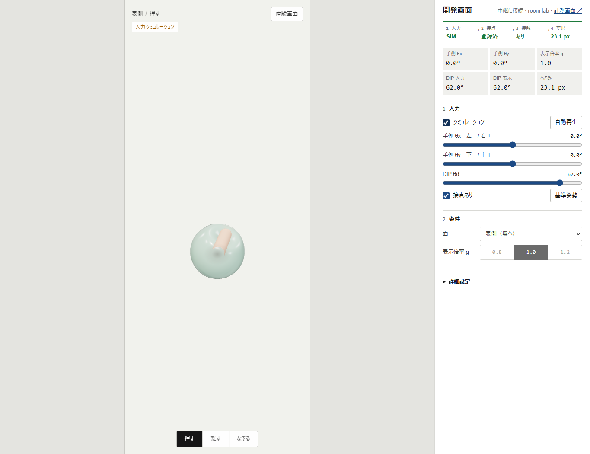

# Pivot Finger Lab

曲げた人差し指の**PIP（第2関節）付近をガラスの支点にして、その続きに見える仮想の中節・末節で、固定されたジェル球に触る**Webプロトタイプです。`pivot-finger-prototype-cli-prompt.md`と提供された手の図をもとに、以前の実装を置き換えました。

**[公開表示](https://eisuke29.github.io/fingertip-lab/)** · **[描画確認・再生](https://eisuke29.github.io/fingertip-lab/?dev=1)** · [検証範囲](#ビルド検証公開) · **[リンク集](リンク集.md)**

公開URLは同じレンダラーで描画と入力シミュレーションを確認できます。実指の入力にはPCのカメラとWebSocket中継が必要です。**実際の手・iPhone Safariでの計測、継ぎ目、触感は未確認**です。



## PCから起動する

Node.js 22.12以上を使用します。初回はこのフォルダで実行してください。

```powershell
npm ci
npm run dev
```

- PCの計測画面：`http://localhost:5173/tracker`
- PCの表示・調整：`http://localhost:5173/?dev=1`
- iPhoneの表示：ターミナル、または計測画面に表示される **`http://PCのLANアドレス:5173`**

PCとiPhoneを同じWi-Fiにつなぎます。Windowsのネットワークアクセス確認が出たら、使用中のプライベートネットワークで許可してください。仮想ネットワークを使っているPCでは複数のアドレスが出ます。iPhoneから届くWi-Fiのアドレスを使います。カメラ取得はPCの**localhost**で行い、iPhoneではカメラ権限を要求しません。

ルームを分ける場合は、両画面のURLに同じ `?room=study01` を指定します。開発画面は `?dev=1&room=study01` です。1ルームにつき送信画面は1つです。

## 最初の置き方と校正

1. **端末を固定する。** 最初は縦画面をスタンドに立てるか、反対の手で安定させます。ユーザーの視点もなるべく固定します。MCP・PIP・DIP・指先の外側が見える位置に外部カメラを置きます。指や端末を無理に押し付けないでください。
2. **PCで計測を開始する。** MediaPipeを第一候補とします。人差し指が隠れる場合は「4色マーカー」に切り替え、MCP（または近位節の目印）・PIP・DIP・指先へ互いに異なる鮮やかな目印を付けます。3点だけでは手側の向きを分離できません。PC画面で色を採取でき、鏡像プレビューを選んでも元画像の座標で処理します。
3. **まず面内1軸で校正する。** 横視点で①楽な接触姿勢を基準に記録、②DIPを保って手側を画面の下へ倒して記録、③手側を基準に戻してDIPだけ曲げて記録します。各姿勢は約0.5秒止めます。カメラの見え方に対する下方向をここで決めます。固定した2D横視点から送るのはこの面内の上下とDIPだけです。
4. **必要な場合に2軸を校正する。** MediaPipeの「単眼3D推定」では斜め視点に置き、下方向に加えて、基準から手側を画面の左へ倒す姿勢を記録します。二つの回転軸を分離できない場合は記録を拒否します。これは推定値で、実入力の両軸が確認済みという意味ではありません。遮蔽や奥行きを区別できない場合は別視点・別計測が必要です。
5. **スマホで支点を合わせる。** 表側では第2関節付近を印へ当てます。タッチ開始の位置を一度だけ登録し、接触中は固定します。小さく滑っても根元や角度は動きません。手側を下へ倒すと中節が上、左へ倒すと中節が右へ向く対応です。面内1軸では横方向を入力しません。
6. **実指に合わせて調整する。** スマホの「調整」から継ぎ目のXY補正、指の太さ・二節の長さ、皮膚色、根元の向き、基準DIP角を合わせます。PIPの骨中心と皮膚接点の差もここで補正します。指腹が球の手前で見え、自然なDIPの曲げで縁を中心側へ押せるよう、球の大きさと奥行きを指を離した状態で調整します。操作中は球の中心を動かしません。

端末の画面向きはPC側の選択と合わせます。画面が回転すると入力を止め、接点の再登録を要求します。カメラ・端末の設置や鏡像設定を変えた場合は校正をやり直してください。IMUは角度入力に使用していません。手持ちで端末が動く状態の補正は未実装です。

## タッチが反応しないとき・裏側

PIP付近の皮膚でタッチを維持できるかは端末ごとに確認が必要です。反応しない場合は開発画面の「接触検出」で「カメラ固定点」を選びます。計測画面の「3 接触判定（固定点）」で「有効にする」を入れ、校正したPIPの画像座標が基準付近にある間を接触候補とします。**これは固定設置での位置合わせ補助であり、ガラスまでの距離を計測するものではありません。** 初回と追跡復帰後は許可を一度切り、接点を合わせてから入れ直します。

裏側は開発画面の「面」で「裏側（手前へ出る）」を選び、ケース背面に印を付けて支点を合わせます。外部カメラから背面の4点が見える配置で別に校正します。背面のPIPから端末厚8px相当を遮蔽し、手前へ出る二節だけを描画します。前面へのタッチは使わず、上記の固定点の接触確認を使います。裏側の持ち方・実指の遮蔽・継ぎ目は実機で調整が必要です。

## 三つの場面

通常画面に常設する主な操作は場面切り替えです。最初の接点ガイドは接触後に消えます。

| 場面 | 反応 |
| --- | --- |
| 押す | 指腹が球へ届いた場所だけへこみ、その周囲が少し膨らむ。静止した角度では形を保持し、戻すと連続的に復元 |
| 離す | 離れる直前の接触点から指腹へ短い糸を伸ばし、設定した距離で切る |
| なぞる | 接触中の指腹の接線方向移動で、その近傍の細かな表面模様をずらす。離れると元へ戻す |

モデルは固定長のPIP→DIPとDIP→指先です。手側の向きはMCP→PIPの相対方向から決め、DIPの入力はPIP→DIPとDIP→指先の相対角の基準からの差です。DIP入力がPIP・DIPの位置や骨の長さへ混入しないよう分離しています。

## 開発画面での確認

開発画面の「1 入力」で「入力シミュレーション」または「自動再生」を使うと、実指と同じ二関節モデル・接触・素材・レンダラーへ角度を入れます。手側X、Y、DIPを別々に動かせます。**シミュレーション中は表示に明記**します。PCの計測画面にも通信確認用のシミュレーションがあります。

```powershell
npm run simulate
```

CLIは12秒間の姿勢列を送ります。スマホでは表側のタッチを維持するか、開発画面をカメラ固定点方式へ切り替えて確認します。別ルームは `npm run simulate -- --room study01`、横画面は `--rotation 90` を指定します。

表示倍率 **g = 接触後の仮想DIP角変化 ÷ 入力DIP角変化**。初期値1.0、開発用0.8/1.0/1.2は球に触れていないときだけ変更できます。自由空間は等倍、球の縁に初めて届くDIP角からの押し込み分だけに適用します。支点、中節の向き、二節の長さは変えません。へこみは倍率適用後の指腹から計算します。中節の姿勢が変わった場合は、その姿勢での到達境界を再計算します。

素材だけを比較するときはg=1.0のまま、へこみの広がり一つを変更します。「根元だけに作る隙間」は描画のクリッピングだけを変え、指先軌跡・球・変形を変えません。外見と物理軌跡を同じにした条件比較用です。知覚上の硬さ・粘り・抵抗や身体所有感の効果は検証していません。

## 追跡の欠落とデータ

- 推定が無効になった場合や受信が180msを超えて途切れた場合、最後の姿勢・既存の変形を短く保持し、新しい接触や変形を開始しません。
- 最後の有効入力から650msで接触を解除し、球を復元します。復帰だけでは再開せず、表側は一度離して当て直し、固定点方式は許可を切って合わせ直します。
- 画像はPCのブラウザ内だけで処理します。中継は3つの角度、連番、計測元、有効・校正・接触状態、画面向き、軸モード、時刻だけを送ります。任意の追加フィールドを転送しません。映像を保存しません。
- 校正値はPC画面のメモリ内、表示調整値は表示端末のlocalStorage内にあります。PCとiPhoneでは調整値が別です。

## ビルド・検証・公開

```powershell
npm test
npm run test:browser
npm run build
npm run build:pages
npm run test:pages
```

`npm run build` の後は `npm start` で同じLAN中継付きの本番サーバーを起動できます。GitHub Pagesは `main` へのpushでActionsから公開します。Pagesは静的配信のため、公開URLからPCのローカルカメラ中継へ直接つながりません。実指体験にはPC起動のLANアドレスを使ってください。

MediaPipeモデルは同梱、WASMランタイムは`npm ci`後の`npm run assets`で依存パッケージから配置します。通常は開発・ビルド前に自動実行されます。[第三者ソフトウェア](THIRD_PARTY_NOTICES.md)も参照してください。

## 構成

| ファイル | 役割 |
| --- | --- |
| `src/kinematics.ts` | 固定支点・剛体二節・接触後DIP倍率 |
| `src/material.ts` | 固定球の局所変形・糸・表面模様のずれ |
| `src/scene.ts` | 表裏の遮蔽・皮膚と爪・ジェル・接触影 |
| `src/experience.ts` | 体験と開発画面、接点登録・再登録 |
| `src/calibration.ts` / `src/tracker.ts` | 4点からの独立計測・動作校正・PCカメラ |
| `src/pose-input.ts` / `server.mjs` | 欠落時の保持・解除、同一ポート中継 |

実機では最初に面内1軸の押す動作を成立させ、次に裏側と追加軸を確認してください。固定視点での継ぎ目と、観察点を動かした際の崩れを区別して記録し、手元と画面を同時に映した動画を残す想定です。現時点では実機動画はありません。
