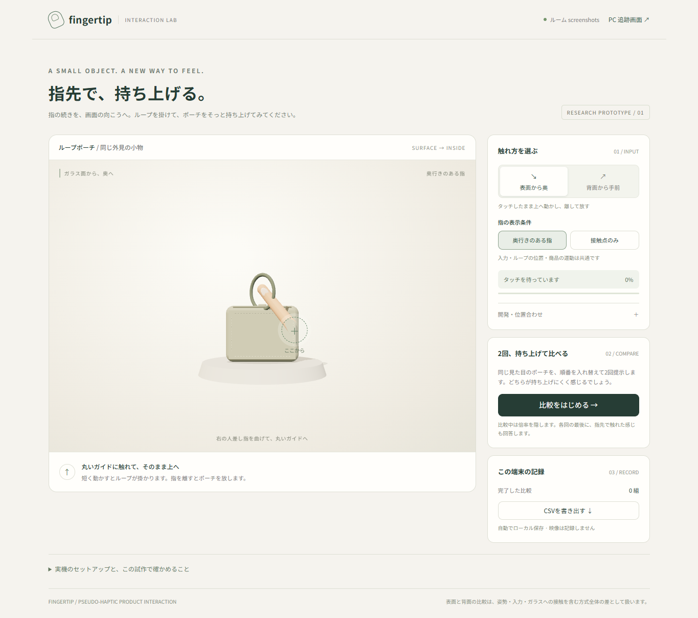

# Fingertip Product Lab

実指から続いて見える仮想の指先で、ループ付きポーチを持ち上げる研究用Webプロトタイプです。

**[公開デモを開く](https://eisuke29.github.io/fingertip-lab/)** · [ソースコード](https://github.com/Eisuke29/fingertip-lab)

公開デモでは**表面タッチ・2回比較・CSV保存**を試せます。背面の実カメラ操作にはWebSocketサーバーが必要なため、以下の手順でPCから起動してください。



- **表面から奥**：Pointer Eventsによるタッチ座標と上への移動を使用。指の根元がタッチ位置についてきます。
- **背面から手前**：PCカメラの3色マーカーから相対曲げ量を求め、WebSocketでスマホへ送ります。商品画面へのタッチは不要です。
- **共通の操作**：接近 → 引っ掛ける → 持ち上げる → 放す → 置き台へ戻る。
- **比較**：同じ外見の2回提示、順序の入れ替え、倍率の非表示、各回の身体感覚の回答、持ち上げにくかった提示の選択。
- **記録**：端末のlocalStorageへ保存し、CSVで取り出せます。カメラ映像は送信・保存しません。

## 起動

Node.js **22.12以上**が必要です。開発・確認に使用した環境はNode.js 24 / Windowsです。

PowerShellでこのフォルダに移動して、初回だけ依存をインストールします。

```powershell
git clone https://github.com/Eisuke29/fingertip-lab.git
cd fingertip-lab
npm.cmd install
npm.cmd run dev
```

2回目からは `npm.cmd run dev` だけです。商品画面、追跡画面、WebSocketが**同じ5173番ポート**で起動します。依存は `node_modules` に置かれ、実行中にCDNへアクセスする必要はありません。

| 用途 | URL |
| --- | --- |
| PCの商品画面 | <http://localhost:5173> |
| PCのカメラ画面 | <http://localhost:5173/tracker> |
| 接続状態 | <http://localhost:5173/api/health> |
| スマホから開ける候補アドレス | <http://localhost:5173/api/network> |

### スマホで開く

1. PCとiPhoneを同じWi-Fiへ接続します。
2. 起動時のターミナルに表示される `LAN phone` のアドレスを、iPhoneのSafariで開きます。商品画面の「実機のセットアップ」や追跡画面の「スマホで開く」にも候補を表示します。
3. アドレスが複数ある場合は、PCで `ipconfig` を実行し、Wi-FiアダプターのIPv4アドレスを使います。例：`http://192.168.1.20:5173`。VPNや仮想アダプターのアドレスはスマホから届かない場合があります。
4. 接続できない場合は、同じネットワークか、Wi-Fiの端末間通信が許可されているか、WindowsのファイアウォールがNode.jsのプライベートネットワーク通信を許可しているかを確認します。

スマホ側は通常のHTTPで動作し、カメラ・マイク・モーションの許可は不要です。**PCのカメラ画面は `localhost` で開いてください**。LANのHTTP URLでは `getUserMedia` を使えないブラウザーがあります。

初期ルームは `lab`。複数端末を分けるときは、PC・スマホの両方で `?room=任意の英数字` を付けます。例：`http://localhost:5173/tracker?room=study01` と `http://PCのIP:5173/?room=study01`。同じルームに接続できる送信元は1つです。

## 表面方式

1. 端末を机に置くか、左手で支えます。
2. 商品画面で「表面から奥」を選びます。
3. 曲げた右人差し指を、丸い「ここから」ガイドに当てます。
4. 触れたまま少し上に動かすとループが掛かります。続けて動かすと持ち上がり、指を離すと放します。

初期の向きは斜め左上です。「開発・位置合わせ」で、実指の**曲がる手前の軸**と仮想指の輪郭がつながるよう、向き・幅・つなぎ目のX/Yを合わせます。値はその端末に保存します。

根元の計算には操作領域の `getBoundingClientRect()` とCSSピクセルを使っています。Canvasの内部解像度やdevicePixelRatioを入力値には使用しません。回転・リサイズは掴みを解除して再配置します。

タッチ圧は使用しません。上方向の移動量を0〜1に換算し、1本のポインターだけをキャプチャします。スクロールの抑制はCanvasだけに適用します。キャンセル、フォーカス喪失、ページ非表示・離脱でも掴みを解除します。

## 背面方式：実カメラ

### 手とカメラを置く

1. 右手で端末を縦持ちします。爪側から第一関節がDIP、第二関節がPIPです。
2. DIPとPIPの間の指の背を、充電口側へ向けて背面へ沿わせます。DIPより先が曲げ戻しできるようにします。
3. 横から見える場所に、**互いに違う色**の小さな目印を3個貼ります。初期色はピンク・水色・黄色ですが変更できます。
   - 1：PIP側の中節
   - 2：DIPの横
   - 3：爪側の末節
4. 端末と接触する場所、関節の折れ目を避けます。
5. PCカメラをスマホの側面から少し背面側に置きます。曲げても3点が端末の裏へ隠れない配置にします。320px幅の処理映像で各点の間が10px以上になる距離を確保します。

### キャリブレーション

1. PCの <http://localhost:5173/tracker> を開き、「カメラを起動」を押して許可します。使用するカメラも選べます。
2. 「PIP側の中節を選ぶ」を押し、映像内の対応する目印をクリックします。残り2点も同様に選びます。色と追跡の初期位置を設定します。
3. 映像上の番号・検出点・2本の線が、実際の3点についていることを確認します。必要なら「色相の許容幅」を調整します。
4. 指を伸ばして止め、「伸ばした姿勢を記録」。約1秒・24フレーム以上から中央値を記録します。
5. 楽に曲げて止め、「楽に曲げた姿勢を記録」。両姿勢の映像上の曲げ差が15°未満、または動きが大きすぎる場合は記録をやり直します。
6. スマホの商品画面で「背面から手前」を選びます。最初に約0.2秒伸ばし、待機状態を解除します。
7. 曲げると引っ掛かって持ち上がり、伸ばして戻すと放します。操作中に画面の表面を触る必要はありません。

2本の画像上のベクトルの相対角から**一軸の操作量**を計算します。正規化後に時定数75msの平滑化をかけます。カメラから絶対的な3D関節角度を得たとは扱いません。剛体としての画像内移動・回転に対して相対角は不変ですが、手首の三次元回転・遠近・隠れについては実機確認が必要です。

色の連結領域について、面積・前フレームからの移動距離・面積の変化を確認します。点の欠落、間隔不足、重なりは無効です。追跡が大きく外れた場合は背景へ再捕捉せず、映像の目印を選び直してください。画角を変えたら位置と姿勢を再記録します。

### 追跡が途切れたとき

- 短い途切れは最後の姿勢を保持します。
- 最後の有効データから650msを超えると商品を放し、「追跡が途切れました」を表示します。
- 復帰後は、曲がった姿勢のまま自動で掴み直しません。0.065以下のニュートラルを約180ms保つと再開できます。
- 掴み開始は0.14以上、背面での解放は0.065以下です。
- 送信時刻ではなく、スマホでの受信時刻で途切れを判定します。連番の重複・逆行も無視します。

## カメラなしで経路を確認する

PCの `/tracker` で「入力シミュレーション」を選び、スライダーか「伸ばす → 持ち上げる → 放す」を使います。スマホ側は「背面から手前」にします。**実カメラと同じWebSocketサーバー経由**で操作量が届きます。

スマホ画面には「入力シミュレーション」、CSVには `input_source=simulation` を明示します。

CLI送信も使えます。先に同じルームの追跡画面を閉じ、開発サーバーを起動したまま、別のPowerShellで実行します。

```powershell
npm.cmd run simulate
# ルームを分ける場合
npm.cmd run simulate -- --room study01
```

## 表示倍率と比較試行

- 接触前は等倍です。接触後の入力の**増分**に表示倍率 `g` を掛けます。
- 初期候補は `0.75 / 1.00 / 1.25`。開発設定では0.5〜1.5で動かせます。
- 表示倍率を途中で変えても、変更した瞬間の指先の位置は維持します。その後の移動から新しい倍率を使用します。
- 表面の根元は倍率で動かしません。持ち上げ中は、ポーチのループの接触点を表示中の先端に一致させます。
- 「奥行きのある指」と「接触点のみ」は描画だけを切り替え、入力・接触判定・商品の運動には同じ処理を使います。
- 表面の仮想指は `z<0`、背面の先端は `z>0`。ガラス面は `z=0`、カメラは `z>0` 側に置きます。

比較を開始すると倍率の設定欄を隠し、入力方式と表示条件を固定します。最初の提示順は乱数で決め、同じ条件での次の組は順序を反転します。

各回で18px以上の持ち上げと解放を確認した後に、「自分の指先で触れた感じ」を1〜7で回答します。2回を終えたら「どちらが持ち上げにくかったか」を回答します。入力中断や追跡の長い欠落が起きた試行は中断として残し、やり直します。実カメラとシミュレーションの入力元が途中で切り替わった場合も同様です。

比較は**同じ入力方式の中で、指表示と接触点表示を比較する**ことを主眼にしています。表示条件ごとに別の組を実施してください。表面と背面の間には、姿勢・入力・ガラスに触れる感覚の違いも含まれます。

## CSVと保存

「CSVを書き出す」でUTF-8 BOM付きCSVを保存します。Excelでの日本語の読み込みを考慮しています。

| 行の種類 | 主な項目 |
| --- | --- |
| `pair` | セッションID、組ID、入力方式、表示条件、提示順、持ち上げにくさの選択 |
| `trial` | 試行ID、提示番号、やり直し回数、入力元、倍率、身体感覚1〜7、接触・離脱時刻、中断・完了状態 |
| `event` | 接触、持ち上げ、離脱、追跡状態、条件変更、選択、時刻、入力値、表示変位、取得連番、理由 |

保存先は**そのブラウザー・そのホストのlocalStorage**です。PCとスマホの記録は別です。ブラウザーデータの消去・プライベートブラウズ等では保存が維持されないことがあります。実験の区切りでCSVを保存してください。保存に失敗した場合は画面に表示します。

カメラ画像、参加者名、実物の重量は記録しません。ブラウザーを再読み込みした際の未完了試行は中断として残します。

## 構成と確認コマンド

```text
server.mjs               HTTP・Vite・WebSocketを同じポートで起動
server/protocol.mjs      送信データの検証
src/interaction.ts       両方式の共通操作・表示倍率・置き台への復帰
src/product-app.ts       Pointer Events、比較試行、商品画面
src/scene.ts             Three.jsの指・爪・ループ・ポーチ・陰影
src/marker-tracking.ts   3色の連結領域、相対曲げ量、姿勢の記録
src/tracker.ts           PCカメラと入力シミュレーション
src/rear-input.ts        連番・途切れ・ニュートラル復帰
src/records.ts           ローカル保存・CSV
tests/                   計算のテストとブラウザーでの操作テスト
```

```powershell
npm.cmd test
npm.cmd run build
npm.cmd run test:browser
npm.cmd run build:pages
npm.cmd run test:pages
```

ブラウザーテストはWindowsの標準パスにあるChromeを利用します。別の場所にある場合は `$env:CHROME_PATH='実行ファイルのパス'` を指定します。Chromeがない環境では `npx.cmd playwright install chromium` でテスト用Chromiumを導入できます。カメラのテストにはブラウザーの**模擬カメラ**を使い、実際のWebカメラにはアクセスしません。スクリーンショットは `artifacts/` に出力します。

ビルド済みファイルを同じWebSocket付きサーバーで動かす場合：

```powershell
npm.cmd run build
npm.cmd start
```

## GitHub Pagesへの公開

`main` へpushすると、GitHub Actionsがテスト、Pages用ビルド、デプロイを実行します。初期の公開先は <https://eisuke29.github.io/fingertip-lab/> です。

- 通常の `npm run build` はPCサーバー用の `dist/`、`npm run build:pages` は公開デモ用の `dist-pages/` に出力します。
- Pagesではリポジトリのパス `/fingertip-lab/` を基準にアセットとリンクを解決します。
- 公開デモは中継サーバーへ接続しません。背面モードは無効にし、追跡画面へのリンクはPCでの起動手順を表示します。
- 比較とCSVの記録は公開URLでも端末内に保存します。ローカルPC版とはホストが異なるため、記録は別です。
- PC用のHTTP・カメラ・WebSocketの経路は従来どおり利用できます。

公開デモをローカルで確認する場合は `npm run build:pages` の後で `npm run preview:pages` を実行し、`http://127.0.0.1:4173/fingertip-lab/` を開きます。

## 確認できた範囲と、実機で確認すること

開発環境の確認結果は [VERIFICATION.md](VERIFICATION.md) に記載します。

次の項目は実際のiPhone・手・3色マーカー・PCカメラを使って確認してください。

- 表面の実指の幅・輪郭の向き・接続位置が連続して見えるか。指の投影の外に、仮想の先端や商品が見えるか。
- 背面で3点が曲げ戻しの全域で見え、DIPの曲げを止めたときに商品も止まるか。
- 手首だけ動かしたときや持ち直したときに、商品が勝手に持ち上がらないか。
- iPhone Safariで回転・ページ移動・復帰をした際の解除と位置合わせ。
- g=1.25でも端がすぐ画面外へ切れないか。必要に応じて操作量と持ち方を調整すること。
- この表示が「自分の指先で触れた感じ」や「持ち上げにくさ」に影響するか。

仕様にある左右2枚の参考図は提供ファイル内にありませんでした。指は調整できる簡易形状で実装しています。図との厳密な一致と、実指による遮蔽の具合は追加の確認事項です。

IMUによる入力、実物重量の推定、貼りつき・滑りの条件は実装範囲に含めていません。

## 実装時に確認した公式仕様

- [Vite JavaScript API](https://vite.dev/guide/api-javascript.html)：同一HTTPサーバーへの開発用middleware接続。
- [Three.js](https://threejs.org/docs/)：3D描画・奥行き・陰影。
- [Pointer capture](https://developer.mozilla.org/en-US/docs/Web/API/Element/setPointerCapture)：操作中のポインター追跡。
- [getUserMedia](https://developer.mozilla.org/en-US/docs/Web/API/MediaDevices/getUserMedia)：PCでのカメラ入力とセキュアコンテキストの条件。

先行研究の位置付けは元の仕様を参照してください。この実装だけで効果が実証されたとは扱いません。
